<!-- .slide: class="slide-cover" -->

# Aimer le dev à l'ère de l'**IA**

## Mathieu Durand & Stéphane Spassevitch

### Breizhcamp 2026

<aside class="notes">
Stéphane
</aside>

---

<!-- .slide: class="slide-section" --> 

Partie 1 / 4

## Qui on est, pourquoi on est là ?

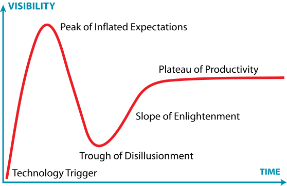
Gartner — Hype Cycle

<aside class="notes">
Stéphane
</aside>

---

<!-- .slide: class="slide-cover" -->

# Mathieu Durand

## Architecte... Développeur avant tout<!-- .element: class="text-accent" -->

depuis 2010
<!-- .element: class="text-muted" style="font-size:.7em; letter-spacing:0.2em; text-transform:uppercase; margin-top:8px;" -->

Craft<!-- 
-->SOLID<!-- 
-->Clean Code<!-- 
-->YAGNI<!-- 
-->Mob<!-- 
--><!-- 
-->KISS<!-- 
-->TDD<!-- 
-->FIRST<!-- 
-->XP<!-- 
-->DRY<!-- 
-->Coding Dojo

<!-- .element: class="fragment fade-in" -->

<aside class="notes">
Mathieu
</aside>

---

<!-- .slide: class="slide-cover" -->

# Stéphane Spassevitch

## Product Engineer<!-- .element: class="text-accent" -->

depuis 2020
<!-- .element: class="text-muted" style="font-size:0.7em; letter-spacing:0.2em; text-transform:uppercase; margin-top:8px;" -->

Pas adepte des acronymes
Produit

<!-- .element: class="fragment fade-in" -->

<aside class="notes">
Stéphane
</aside>

---

<!-- .slide: class="slide-poll" -->

🙋 Et vous ?

## C'est quoi être dev pour vous ?

concevoir
traduire
créer
livrer
solutionner
comprendre
apprendre
automatiser
partager

<aside class="notes">
Mathieu (Stéphane rebondit sur les termes)
</aside>

---

## Trois raisons d'aimer ce métier

Le code & le craft

créer

concevoir automatiser

Valeur produit

solutionner

traduire livrer

Apprendre & transmettre

comprendre

apprendre partager

### Ce qu'on aime dans ce métier... tous impactés par l'IA. Pas de la même façon.

<aside class="notes">
Mathieu
</aside>

---

<!-- .slide: class="slide-section" -->

## Valoriser le produit &nbsp;vs&nbsp; Valoriser le code

<aside class="notes">
Mathieu
</aside>

---

<!-- .slide: class="slide-discuss" -->

## C'est quoi notre usage de l'IA ?

<aside class="notes">
Mathieu
</aside>

---

## Le métier change, nous aussi

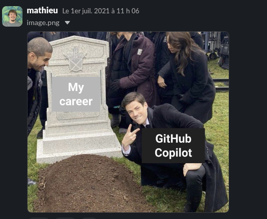

Juillet 2021 — Mathieu sur Slack

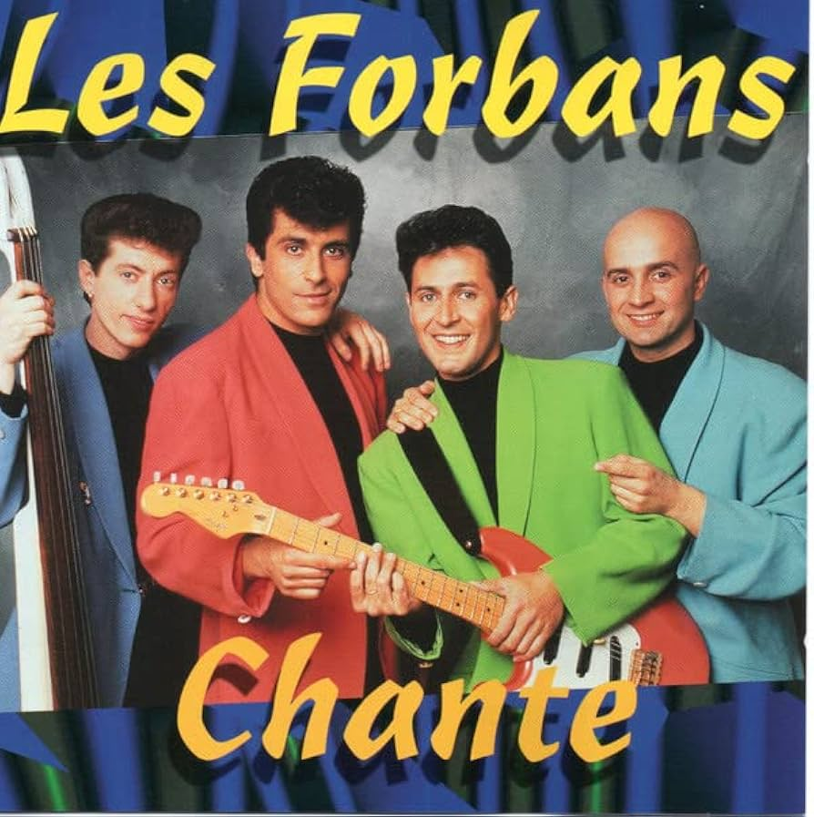

**2021** : le mème qu'on envoie en rigolant

**2023** : on dévore Copilot. L'autocomplétion sous stéroïdes."Chouette, c'est sympa tu verras"

**2024** : Cursor. Effet waouh sur le dev agentique.

**Été 2025** : Claude Code. Un CLI ? Ça tombe bien, j'aimais pas VSCode.

**Fin 2025** : skills, hooks, MCP. On devient power user.

**Aujourd'hui** : plus une ligne de code écrite à la main, ni US, ni doc, ni maquette, ni UX.

<aside class="notes">
Mathieu 2021
Stéphane 2023 - 2024
Mathieu Fin
</aside>

---

<!-- .slide: class="slide-section" -->

Partie 2 / 4

## Ce qui a changé dans nos journées

<aside class="notes">
Mathieu
</aside>

---

<!-- .slide: class="slide-section" -->

2a

## La nouvelle nature de notre travail

<aside class="notes">
Mathieu
</aside>

---

<!-- .slide: class="slide-poll" -->

🙋 Et vous ?

## À l'heure de l'IA, aimez-vous davantage ou moins votre métier ?

<aside class="notes">
Mathieu
</aside>

---

<!-- .slide: class="slide-section" -->

## Faire &nbsp;vs&nbsp; Superviser

<aside class="notes">
Mathieu
</aside>

---

## Du **producteur** au manager de flux

- Le code, c'était notre matière. On le pensait, on le possédait, on le façonnait.
- Maintenant on orchestre des agents. On relit leurs sorties, on les recadre.

Le livrable est le même. 

Le chemin pour y arriver, plus du tout.

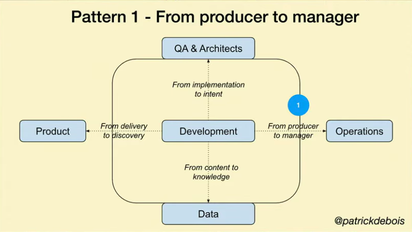
Patrick Debois — The New AI Native Dev Coding Workflow · Devoxx 2025

<aside class="notes">
Mathieu
</aside>

---

## The Software Development Lifecycle Is Dead

<em>"The SDLC you learned is a relic."</em>

<em>"AI-native engineers don't know what the SDLC is."</em>

<em>"They just build things."</em>

<em>"And honestly? I’m jealous."</em>

Boris Tane — The Software Development Lifecycle Is Dead · boristane.com · 2025

<aside class="notes">
Mathieu
</aside>

---

## The Software Development Lifecycle Is Dead

  
Avant

  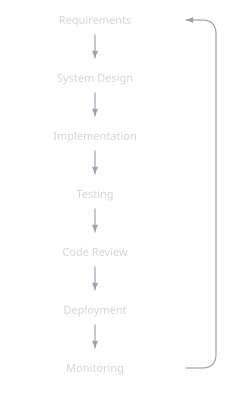

  
Après

  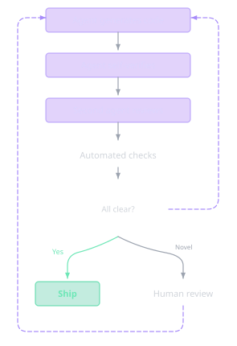

<aside class="notes">
Mathieu
</aside>

---

<!-- .slide: class="slide-section" -->

<h2 style="margin:0 0 16px; font-size:1.6em; line-height:1.2;"><em>"15h !  plus de tokens, ... et maintenant, que vais-je  faire ?"</em></h2>
— Un dev AI-Native

Source : LinkedIn

<aside class="notes">
Mathieu & Stéphane
</aside>

---

<!-- .slide: class="slide-section" -->

2b

## Le coût caché

<aside class="notes">
Stéphane
</aside>

---

## Après la dette technique,    la dette cognitive.

- **Le mythe du soulagement** : déléguer le code n'allège pas l'esprit, il l'engourdit.
- **Multitasking** : la charge a muté, on lit et on supervise en parallèle toute la journée.
- **L'amnésie du développeur** : une dette de mémoire s'installe.

−55 %
de connectivité neuronale chez les rédacteurs assistés par IA (écart maximal, EEG)

83 %
incapables de citer un passage qu'ils viennent de faire générer  (11 % sans IA)

Sources : MIT Media Lab — Your Brain on ChatGPT, Kosmyna et al. · 2025

<aside class="notes">
Stéphane
 - la dette cognitive qu'on est tous en train d’alimenter là depuis seulement quelques mois
 - l’effort s’est déplace vers le contrôle, la supervision et le multitasking
 - il génère une surcharge décisionnelle et mentale beaucoup plus épuisante qu'une session de code sur un problème précis
 - Etude
 - On assiste à un déchargement cognitif massif : le cerveau devient "flemmard"
-> on ne perd pas seulement une compétence technique, on détruit notre capacité même à juger, interpréter et délibérer

 Cette dette cognitive va venir au fur et à mesure s'ajouter à la dette tout court de nos projets

</aside>

---

## Jamais autant produit, jamais aussi seul.

- **L'illusion du « Yes Man  »** : on code plus vite, mais seul face à un agent qui valide tout.
- **Le tunnel du vibe coding** : une solution statistiquement correcte, sans la confrontation d'idées ni les « <strong style="color:var(--mauve);"> questions bêtes  </strong>» qui sauvent un produit.

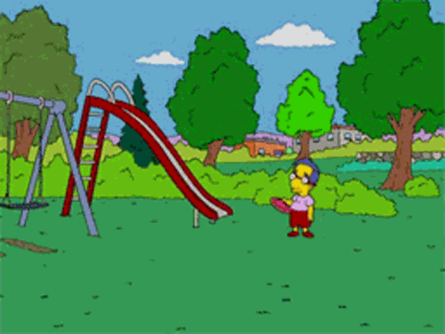

<aside class="notes">
Stéphane
 - mais de + en + les équipes se réduisent
 - dialoguer avec nos prompts et cela nous enferme dans un tunnel. il manquera la richesse d'un dialogue entre humains , la confrontation des idées, le jugement de nos pairs qu'on néglige de plus en plus à la faveur de ce surplus de production, on a aussi moins les questions un peu bêtes qui peuvent sauver un produit...->on perd le fruit de l'intelligence collective
 - moins d'intelligence collective et aussi moins de confrontation parceque par défaut, les llm sont façonnés pour éviter toute frictions
 - apprauvissement des compétences au sein des équipes techniques, on alimente la solitude du developpeur on l’a évoque et  aussi un appauvrissement du produit et ça m'amène à la slide suivante
</aside>

---

## L'autoroute de l'IA tue la créativité.

145 études
convergent : la contrainte nourrit la créativité. L'implémentation gratuite la tue.

Sources : Acar, Tarakci & van Knippenberg — Creativity and Innovation Under Constraints, Journal of Management · 2019

<aside class="notes">
Stéphane
 - Ce qu'on a gagné en aisance , on le perd en substance, 
Historiquement le tps et la douleur de l'implémentation agissait comme un filtre naturel : on ne codait que les idées qui en valaient vraiment la peine
 - en supprimant cette friction, et en n’en faisant une autoroute, l'implémentation gratuite génère une obésité logicielle et ça a comme conséquence de noyer la vertébrale innovation parce qu'on va la surcharger de fonctionnalités inutiles
 - l'IA produit une boucle de récompense immédiate, exactement comme dans les jeux vidéo -> excitation chronique épuise nos cerveaux
 - Le code plus lisse, stérile, fondé sur des moyennes statistiques. On y perd le sang et les tripes qu'on pouvait mettre dans notre code. On tue l'incarnation du code par les devs et donc leur maîtrise mais aussi leur alignement sur le projet.
 -Bien mal acquis, ne profite jamais, on a ici une conclusion de plus de 145 études menées en 2019 qui convergent justement vers la même idée, sans contrainte, pas de créativité -> l'implémentation gratuite la tue. 
</aside>

---

## La déformation   silencieuse.

- **Chez le senior** : une atrophie cérébrale, réversible.
> En médecine, premier *deskilling* documenté : habitués à l'IA, les médecins détectent **20 % de lésions précancéreuses en moins** sans elle.
<!-- .element: style="margin-top: 24px;" -->
- **Chez l'apprenti** : qui délègue avant d'avoir acquis les bases → <strong style="color:var(--mauve);"> *dépossession cognitive* </strong>, une génération incapable de réflexion critique.

Sources : Arnaud Giuliani (Kotzilla) — The Next Software Crisis Won't Be About Writing Code · 2025 ; Budzyń et al. — Endoscopist deskilling risk after exposure to AI in colonoscopy, The Lancet Gastroenterology &amp; Hepatology · 2025

<aside class="notes">
Stéphane
 - on constate une atrophie de notre capacité à réfléchir, à raisonner; et il y a pas mal d'études qui sortent en ce moment sur ce suje
 - Etude
 - Si un médecin se laisse berner, croyez-vous qu'un dev fatigué repérera un bug vicieux dans une PR de 400 lignes ?
 -même nous, en terme de dépendance, combien de fois on va demander à Claude des choses simple qu'on aurait pu réaliser avce un minimum d'effort mais vu que ça va plus vite, qu'on a l'impression que c'est moins fatiguant
  -  il y a un vrai risque pour nous, et aussi pour ceux qui nous suivent comment dans ces conditions former des générations incapables de penser par eux même incapables, d’avoir du discernement et incapble de concevoir un système mais juste des simples opérateurs
- la souffrance des premières années n'était pas un obstacle, c'était la leçon, prendre des murs c'est ce qui nous a tous fait progresser, sans murs->
 comment vont-ils progresser
</aside>

---

<!-- .slide: class="slide-section" -->

Partie 3 / 4

## Les effets de bord qui font mal

<aside class="notes">
Mathieu
</aside>

---

## On *croit* aller 20 % plus vite. On livre 19 % plus lentement.

- **L'écriture du code est une partie de notre travail** :  Mais quel pourcentage ?
- **L'effondrement de la qualité** : désincarnation du code
- **Le goulot de la relecture**: combien peut-on gérer de PR ?

11 %
du temps d'un dev passé à écrire du code

×1,7
de bugs en plus dans les PR assistées par IA

500 / 10
PR générées par un agent vs relues par une équipe, par jour

Sources : Dax Raad — The most honest take on AI productivity · 2025 (vélocité −19 %, temps de frappe 11 %, données CodeRabbit ×1,7) ; Boris Tane — The Software Development Lifecycle is Dead · 2025 (500 vs 10 PR)

<aside class="notes">
Mathieu
</aside>

---

## La ligne de code ne vaut plus rien. rien... 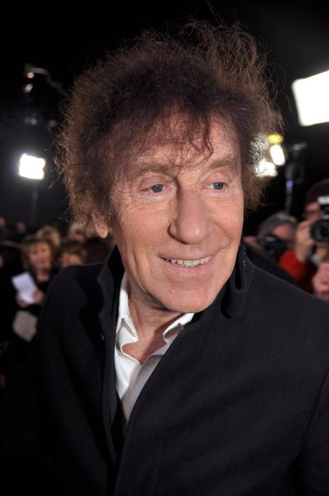 Et la machine divise les équipes.

- **Coder c'est trivial ?**
- <strong> Désacralisation de notre métier</strong>
- **Et si ça marche à 80%, c'est suffisant ?**
- **Fracture idéologique** - <strong style="color:var(--mauve);">accélérationnistes</strong> vs <strong style="color:var(--violet);">résistants</strong>

Source : William Krieg — Le deuil de l'artisan (LinkedIn) · 2025

<aside class="notes">
Stéphane
 - l'acte d'écrire une ligne de code a été complètement désacralisé en quelques mois
 - Mais le piège c'est que ce qui semble aisé pour tout le monde, bah ça devient la norme et donc de - en - de personne non techniques ne comprennent les enjeux, les goulots et les murs qu'on peut encore se prendre
 -Et puis cela a entraîné aussi une grosse polarisation dans notre profession
</aside>

---

## Jamais autant de dette technique, aussi vite. Et les meilleurs finissent par partir . 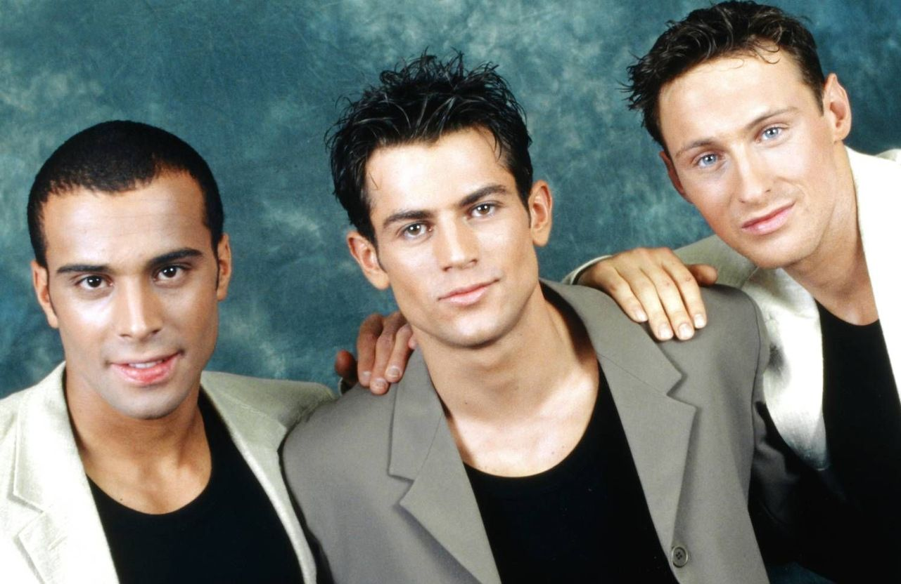

- **La fatigue du débogage mental** : un code généré sans intention de design ne forme pas un système. 
- **L'hémorragie de l'expertise** : le quotidien du senior devient un audit épuisant pour maintenir ce code générique. 

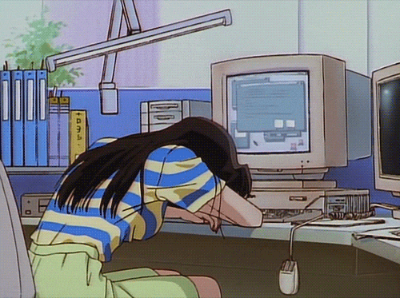

Sources : Arnaud Giuliani (Kotzilla) — The Next Software Crisis Won't Be About Writing Code · 2025 (design intent / « heap ») ; Kin Lane · 2025 ; Dax Raad — The most honest take on AI productivity · 2025

<aside class="notes">
Stéphane
 - jamais autant produit certe mais cela a pour effet aussi de créer encore plus de dette technique en très peu de temps
 - ces profils seniors s'épuisent, se lassent  et finissent par partir, un jour….
</aside>

---

## L'IA ne remplace pas les seniors. Elle détruit le pipeline des juniors.

- **L'illusion de la productivité globale** : l'IA ne profite qu'à ceux qui ont déjà le référentiel pour auditer ses erreurs.
- **La fin des postes d'entrée** : Les offres junior reculent au profit de profils généralistes.

+3,6 %
de gain de productivité, réservé aux développeurs très expérimentés (sur 30 M de commits Python analysés)

Sources : Science — étude sur 30 millions de commits Python · janvier 2026 ; Anthropic / Boris Cherny — recul des offres d'entrée de gamme · 2025

<aside class="notes">
Stéphane
</aside>

---

<!-- .slide: class="slide-closing" -->

## bref.

<aside class="notes">
Mathieu & Stéphane
</aside>

---

<!-- .slide: class="slide-closing" -->

## Merci de votre attention. Et bon courage.

Des questions ?
<!-- .element: class="text-muted" style="margin-top: 32px;" -->

<aside class="notes">
Mathieu & Stéphane
</aside>

---

<!-- .slide: class="slide-section" -->

Partie 4 / 4

## Rester artisan aux commandes

<aside class="notes">
Mathieu
</aside>

---

<!-- .slide: class="slide-section" -->

4a

## Le code reste la spécification

<aside class="notes">
Mathieu
</aside>

---

<!-- .slide: class="slide-poll" -->

🙋 Et vous ?

## Il est mort, le clean code ? 

<aside class="notes">
Mathieu
</aside>

---

## L'exécution devient triviale, la spécification devient vitale.

- **La syntaxe n'est plus l'enjeu** 
- **Le déplacement de l'effort** -  le <strong style="color:var(--mauve);">comment</strong> vers le <strong style="color:var(--violet);">quoi</strong>.

<aside class="notes">
Stéphane
 - Alors si l'éxécution devient triviale, la syntaxe n’est plus l’enjeu, la spécification elle devient vitale essentielle
 - L'effort s'est déplace, on se pose bcp moins la question du comment alors il faut se recentrer sur le quoi, le pourquoi ?
 -  il reste du comment à aller chercher
 - 
</aside>

---

## De l'exécutant au Product Engineer

> La compétence la plus rare n'est plus de construire, c'est de **choisir**.

- **En amont, le <strong style="color:var(--mauve);">*pourquoi* </strong>** : sortir de la « chambre noire » technique pour challenger le besoin et décider ce qui mérite d'exister.
- **En aval, le <strong style="color:var(--violet);">*comment* </strong>** : garder le contrôle en imposant son intention de design à la machine.

> Propriétaire de sa feature à 80 %. Les 20 % restants reviennent à un pair humain.
    

Sources : William Krieg — Le deuil de l'artisan (LinkedIn) · 2025 ; Anthropic — l'IA écrit le code, l'humain orchestre · 2025

<aside class="notes">
Stéphane
 - On adopte une nouvelle posture Product engineer -> 
L'écriture de la syntaxe disparaît, mais l'orchestration d'agents et la réflexion produit prennent sa place (ex: chez Anthropic, l'IA écrit le code, l'humain orchestre le système)
 -En amont (Le Pourquoi) : Il faut sortir de la « chambre noire » pour challenger le besoin
 -En aval (Le Comment) : Garder le contrôle absolu en imposant « l'intention de design » à la machine, notre travail aussi
 - Vous devez sculpter le contexte du modèle, la bonne information au bon moment ni trop d’information ni pas suffisamment
 - Un Product Engineer c’est quoi, c’est on arrête de se définir comme un dev back, front, ops…. Avec nos nouveaux outils on  doit prendre l’ownership de notre feature
 - l'exécution soit menée exactement comment on souhait l'amener dans un tout, avec cohérence, avec intention et donc avec incarnation
 - Et il y a du plaisir à prendre dans cette approche
</aside>

---

## Le courage de ne pas générer

> *Code generated without design intent doesn't form a system, it forms a heap.*
> — Arnaud Giuliani (Kotzilla)

- **Le piège de l'optimisation locale** : l'IA excelle à produire une fonctionnalité isolée, mais elle ne garantit pas la cohérence architecturale globale.
- **La posture de <strong style="color:var(--mauve);">l'artisan en 2026 </strong>** : la discipline de ne pas lancer un agent tout de suite. On pense le système, on valide l'architecture, puis on délègue l'exécution.

Source : Arnaud Giuliani (Kotzilla) — The Next Software Crisis Won't Be About Writing Code · 2025

<aside class="notes">
Stéphane
 - dès qu'il faut parler de cohérence, d'architecture globale et bien c'ets plus compliqué
 - C’est ça le context enginnering
On passe en mode contre-maitre on pense architecture, on pense conception systeme et on s'attarde moins sur l'algo, l'écriture en tant que tel, 
On doit faire l’effort de bien comprendre notre système c’est incontournable  , les contraintes qu'on veut imposer et l'intention de code qu'on veut mettre avant même de planifier la feature avec son agent. on garde l’incarnation du code
 - La posture de l'artisan en 2026 ça commence là, on réfléchit, on analyse avant d'ouvrir claude
</aside>

---

<!-- .slide: class="slide-section" -->

4b

## Monter d'un cran

<aside class="notes">
Mathieu
</aside>

---
<!-- .slide: class="slide-section" -->

## La vision globale est à nous
 

## Comprendre pour prompter

<aside class="notes">
Mathieu
</aside>

---

## Allez plus haut 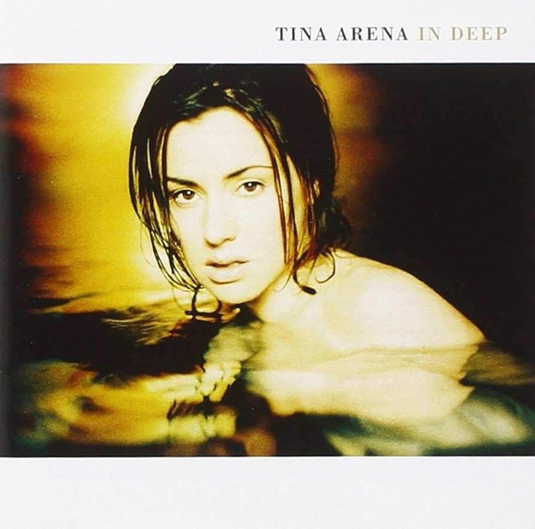

- L'IA voit la fonction, pas le système : cohérence architecturale, interactions, contraintes organisationnelles.
- La conception avant l'agent : dessiner les frontières, nommer les invariants, puis déléguer.
- Ne pas construire est aussi une décision architecturale.
- Les bounded contexts et contrats inter-équipes : personne ne les dessine à notre place.

Bad code + Good architecture = 😌 &nbsp;&nbsp;|&nbsp;&nbsp; Bad code + <em>Bad architecture</em> = 💀

<aside class="notes">
Mathieu
</aside>

---

## Le métier et son langage restent centraux

Le chef dirige parce qu'il connaît chaque instrument.

<aside class="notes">
Mathieu
</aside>

---

## Retour aux fondamentaux

- **Domain-Driven Design** : nommer les concepts du domaine avec précision, c'est donner à l'agent un vocabulaire qu'il ne peut pas inventer seul.
- **Event Storming, Example Mapping** : découvrir et formaliser ce vocabulaire en équipe, avant de déléguer.
- **Architecture Hexagonale** : découper en couches indépendantes permet de régénérer une partie sans contaminer l'ensemble.

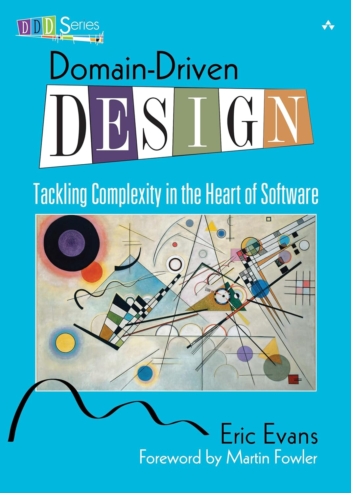

<aside class="notes">
Mathieu
</aside>

---

## L'observabilité, compétence socle

> *The observability layer becomes the feedback mechanism that drives the entire loop.*
> — Boris Tane

- **L'étape qui survit** : Intent. Build. Observe. Repeat.
- **Context Engineering** : nouvelle compétence clé, bornée par l'observabilité
- **Savoir ce qui se passe réellement** : sans culture de l'observabilité, l'accélération par l'IA est aveugle ou auto-destructrice.

<aside class="notes">
Mathieu
</aside>

---

## Chercher les nouvelles technicités

- **Platform Engineering IA** : construire les rails sur lesquels les agents roulent (*pipelines, guardrails, registres de contexte, sandboxes*)
- **Site Reliability Engineering IA** : fiabiliser des systèmes où les agents prennent des décisions non déterministes
- **Industrialiser** : *pipelines, quality gates, tests de contrat*. Ce qui peut être automatisé doit l'être, pour libérer de l'attention sur ce qui ne peut pas l'être.
- **Concevoir l'équipe de demain** : *skills, agents, MCP, context engineering*... Le rythme est trop rapide pour tout mémoriser. Choisir ce qui mérite d'être gardé, formalisé, transmis, c'est un geste d'artisan.

<aside class="notes">
Mathieu
</aside>

---

<!-- .slide: class="slide-section" -->

4c

## Reprendre la main

<aside class="notes">
Stéphane
</aside>

---

## Le goût vient de la friction

Hors-sol Nourrie à la demande, zéro stress. <strong>Aucun goût.</strong>

Pleine terre Soleil, sécheresse, vent. <strong class="text-accent">Le stress concentre les arômes.</strong>

> Ce qui forge notre code, c'est la galère, pas le confort.
<!-- .element: class="fragment" style="margin-top: 20px;" -->

Images : Giancarlo Dessì (CC BY-SA 3.0) · Mhmd.abdrzg (CC BY-SA 4.0) — Wikimedia Commons

<aside class="notes">
Stéphane
 le code généré par l'IA est par nature statistique, générique, et sans signature humaine
Mais c’est un fait, on sait  que les systèmes les plus robustes ont souvent le "grain" de l'imperfection humaine, les aspérités qui rendent le projet solide, incarné par les équipes tech, et c’est dans la difficulté qu’on éprouve du plaisir
</aside>

---

## Réhabiliter la friction

> La friction n'était pas un obstacle. C'était la **leçon**.

- **Le piège du « zéro friction »** : Sans effort de génération, le cerveau ne retient plus rien durablement.
- **La « difficulté désirable »** : un apprentissage ne s'ancre que s'il exige un effort et une part de résistance.
- **L'action** : garder volontairement de la friction, <strong style="color:var(--mauve);">éteindre l'IA </strong> sur les sujets où l'on veut consciemment apprendre ou consolider une compétence.

Sources : Dax Raad — The most honest take on AI productivity · 2025 ; Robert Bjork — Desirable difficulties · UCLA Bjork Learning Lab

<aside class="notes">
Stéphane
 -La friction n'était pas l'obstacle, c'était la leçon" Quand on galérait pendant 4 heures sur un bug à minuit, on se créait un modèle mental en béton
C'est ce que la psychologie appelle les "difficultés désirables"
 - il faut avoir le courage d'éteindre Copilot ou Claude sur les sujets techniques où l'on a besoin d'apprendre. La friction fait la progression du dev mais aussi une partie du plaisir, si tout devient facile, si tout atteignable dans la minute, sans effort, alors où est le plaisir
 - donc on rétablit de la bonne friction, on choisit ce qu’on veut approfondir ou apprendre et on rétablit cette friction qu’on peut timeboxer, borner avec de l’ia aussi alors on va perdre en efficacité oui, dans un premier temps mais à la fin, le dev et le projet seront gagnant

</aside>

---

## Sanctuariser les temps sans production

- **Le retour des fondamentaux** : le TDD, le DDD et le vrai pair-programming humain redeviennent vitaux pour encadrer la machine.
- **L'hygiène de l'ennui** : réapprendre à supporter les temps morts et cultiver la sagesse de l'arrêt volontaire. 

Sources : Arnaud Giuliani (Kotzilla) — The Next Software Crisis Won't Be About Writing Code · 2025 ; Alan — newsletter Intensité · 2025

<aside class="notes">
Stéphane
 - La Clean Architecture n'est pas morte non, c même devenu notre seule vraie barrière de sécurité pour encadrer, contraindre les agents et ça depende du temps de reflexion
 - le rythme devient infernal, l'excitation remplace le stress, et on veut remplir chaque seconde de vide
Appelez à "sanctuariser les temps sans production"
 - c'est bien beau l'artisanat et le temps de séchage, mais comment je justifie ça quand mes concurrents font du vibe coding et pondent 500 PRs par jour  bah on vous l’a donné la réponse, ça ne tient pas dans le temps.
 - Si vous ne financez pas le temps de réflexion produit de vos développeurs, vous accélérez pas votre entreprise : vous accélérez juste la création de votre dette technique et de votre code mort
</aside>

---

## En 2026, qu'est ce qu'on met en place   Pour le plaisir   ? 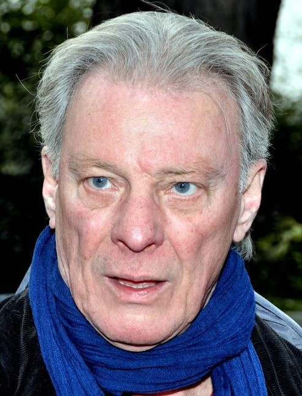

- **❓Prendre le temps** : ce qu'on a gagné sur l'exécution sert à challenger la demande. On prend de la hauteur, on entre dans la décision : on questionne le quoi.
- **🤠 Explorer le « Far West »** : tout est à réinventer, la veille est permanente et stimulante. Le plaisir d'ingénieur se déplace vers la construction de l'écosystème IA de l'équipe.
- **🛠️ Retrouver de la technicité** : le *context engineering* devient un vrai terrain d'ingénieur. On sculpte ce que le modèle voit : Le craft se déplace, il ne disparaît pas.
- **🤝 Le plaisir vient de l'autre** : La compréhension du besoin de son prochain. Libérés de la syntaxe, on revient à ce qui compte : se comprendre entre humains. 

<aside class="notes">
Stéphane & Mathieu (1 par 1)
</aside>

---

<!-- .slide: class="slide-closing" -->

<!-- .element: style="width:120px; margin-bottom: 32px;" -->

## Merci de votre attention. Et bon courage 😉

### 🎤 À vous le micro

Vos questions, vos témoignages.
<!-- .element: style="margin-top: 24px;" -->

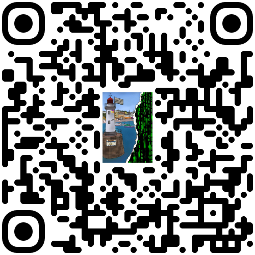
