<!-- .slide: class="slide-cover" -->

# Aimer le dev à l'ère de l'**IA**

## Mathieu Durand & Stéphane Spassevitch

### Matinales Liksi · Nantes, mardi 1er décembre · Rennes, mardi 8 décembre

<aside class="notes">
Stéphane
</aside>

---

<!-- .slide: class="slide-section" --> 

Partie 1 / 4

## Qui on est, pourquoi on est là ?

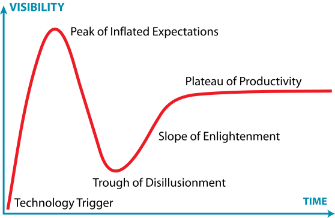
Gartner — Hype Cycle

<aside class="notes">
Stéphane
</aside>

---

<!-- .slide: class="slide-cover" -->

# Mathieu Durand

## Architecte... Développeur avant tout<!-- .element: class="text-accent" -->

depuis 2010
<!-- .element: class="text-muted" style="font-size:.7em; letter-spacing:0.2em; text-transform:uppercase; margin-top:8px;" -->

Craft<!-- 
-->SOLID<!-- 
-->Clean Code<!-- 
-->YAGNI<!-- 
-->Mob<!-- 
--><!-- 
-->KISS<!-- 
-->TDD<!-- 
-->FIRST<!-- 
-->XP<!-- 
-->DRY<!-- 
-->Coding Dojo

<!-- .element: class="fragment fade-in" -->

<aside class="notes">
Mathieu
</aside>

---

<!-- .slide: class="slide-cover" -->

# Stéphane Spassevitch

## Product Engineer<!-- .element: class="text-accent" -->

depuis 2020
<!-- .element: class="text-muted" style="font-size:0.7em; letter-spacing:0.2em; text-transform:uppercase; margin-top:8px;" -->

Pas adepte des acronymes
Produit

<!-- .element: class="fragment fade-in" -->

<aside class="notes">
Stéphane
</aside>

---

<!-- .slide: class="slide-poll" -->

🙋 Et vous ?

## C'est quoi être dev pour vous ?

concevoir
traduire
créer
livrer
solutionner
comprendre
apprendre
automatiser
partager

<aside class="notes">
Mathieu (Stéphane rebondit sur les termes)
</aside>

---

## Trois raisons d'aimer ce métier

Le code & le craft

créer

concevoir automatiser

Valeur produit

solutionner

traduire livrer

Apprendre & transmettre

comprendre

apprendre partager

### Ce qu'on aime dans ce métier... tous impactés par l'IA. Pas de la même façon.

<aside class="notes">
Mathieu
</aside>

---

<!-- .slide: class="slide-section" -->

## Valoriser le produit &nbsp;vs&nbsp; Valoriser le code

<aside class="notes">
Mathieu
 On en retire deux grandes familles (avec de la porosité bien sur) de dev.
  Deux facettes du métier impactées de maniere tres différentes par l'IA
</aside>

---

<!-- .slide: class="slide-discuss" -->

## C'est quoi notre usage de l'IA ?

<aside class="notes">
Mathieu
</aside>

---

## Le métier change, nous aussi

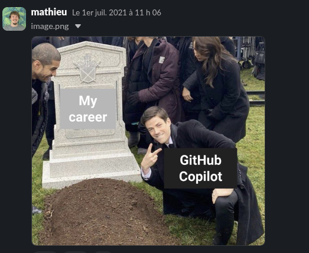

Juillet 2021 — Mathieu sur Slack

**2021** : le mème qu'on envoie en rigolant

**2023** : on dévore Copilot. L'autocomplétion sous stéroïdes.

**2024** : Cursor. Effet waouh sur le dev agentique.

**Été 2025** : Claude Code. Un CLI ? Ça tombe bien, j'aimais pas VSCode.

**Fin 2025** : skills, hooks, MCP. On devient power user.

**2026** : plus une ligne de code écrite à la main, ni US, ni doc, ni maquette, ni UX.

**Aujourd'hui** : workflows agentic & software factory

<aside class="notes">
Mathieu 2021
Stéphane 2023 - 2024
Mathieu Fin
</aside>

---

<!-- .slide: class="slide-section" -->

Partie 2 / 4

## Ce qui a changé dans nos journées

<aside class="notes">
Mathieu
</aside>

---

<!-- .slide: class="slide-section" -->

2a

## La nouvelle nature de notre travail

<aside class="notes">
Mathieu
</aside>

---

<!-- .slide: class="slide-poll" -->

🙋 Et vous ?

## À l'heure de l'IA, aimez-vous davantage ou moins votre métier ?

<aside class="notes">
Mathieu
</aside>

---

<!-- .slide: class="slide-section" -->

## Faire &nbsp;vs&nbsp; Superviser

<aside class="notes">
Mathieu
</aside>

---

## Du **producteur** au manager de flux

- Le code, c'était notre matière. On le pensait, on le possédait, on le façonnait.
- Maintenant on orchestre des agents. On relit leurs sorties, on les recadre.

Le livrable est le même. 

Le chemin pour y arriver, plus du tout.

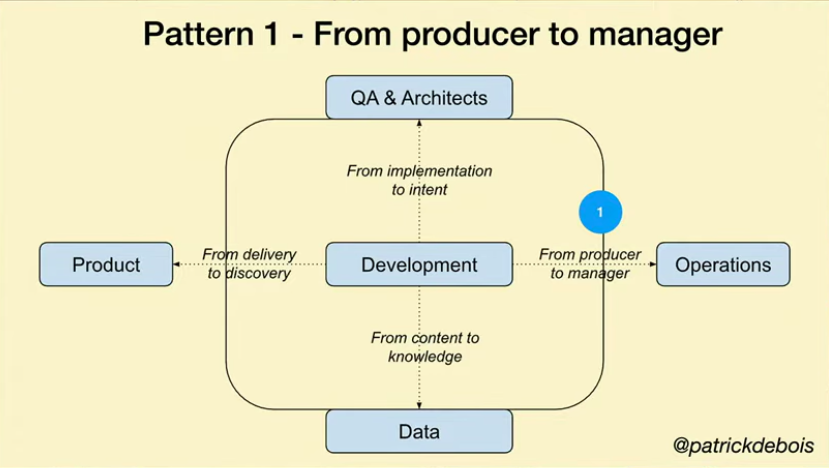
Patrick Debois — The New AI Native Dev Coding Workflow · Devoxx 2025

<aside class="notes">
Mathieu
</aside>

---

## The Software Development Lifecycle Is Dead

<em>"The SDLC you learned is a relic."</em>

<em>"AI-native engineers don't know what the SDLC is."</em>

<em>"They just build things."</em>

<em>"And honestly? I’m jealous."</em>

Boris Tane — The Software Development Lifecycle Is Dead · boristane.com · 2025

<aside class="notes">
Mathieu
</aside>

---

## The Software Development Lifecycle Is Dead

  
Avant

  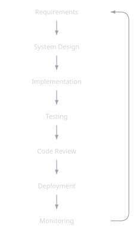
  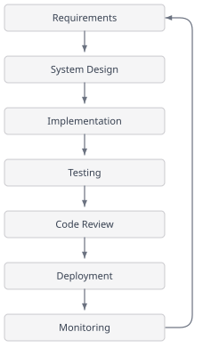

  
Après

  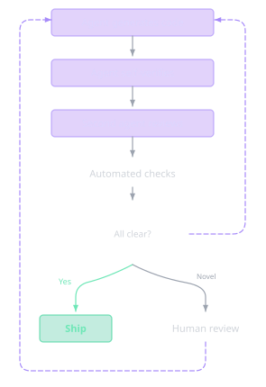
  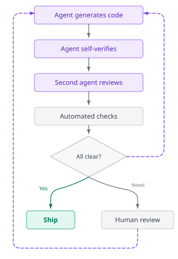

<aside class="notes">
Mathieu
</aside>

---

<!-- .slide: class="slide-section" -->

<h2 style="margin:0 0 24px; font-size:1.6em; line-height:1.2;"><em>« 15h, plus de tokens… Je fais quoi de mon après-midi ? »</em></h2>
— Un dev AI-native

Source : LinkedIn

<aside class="notes">
Mathieu & Stéphane
</aside>

---

<!-- .slide: class="slide-section" -->

2b

## Le coût caché

<aside class="notes">
Stéphane
 Time Code : 12/13min
</aside>

---

## Après la dette technique,    la dette cognitive.

- **Le mythe du soulagement** : déléguer le code n'allège pas l'esprit.
- **Multitasking** : on supervise en parallèle toute la journée.
- **L'amnésie du développeur** : on livre du code qu'on ne sait plus expliquer.

−55 %
de connectivité neuronale chez les rédacteurs assistés par IA (écart maximal, EEG)

−25 %
de bonnes réponses pour les devs qui codent avec l'IA, interrogés sur le code qu'ils viennent d'écrire

Sources : MIT Media Lab — Your Brain on ChatGPT, Kosmyna et al. · 2025 ; Anthropic — How AI assistance impacts the formation of coding skills, Shen &amp; Tamkin · janvier 2026

<aside class="notes">
Stéphane
 - la dette cognitive qu'on est tous en train d’alimenter là depuis seulement quelques mois
 - l’effort s’est déplace vers le contrôle, la supervision et le multitasking
 - déléguer le code n'allège pas l'esprit, il l'engourdit.
 - il génère une surcharge décisionnelle et mentale beaucoup plus épuisante qu'une session de code sur un problème précis
 - Etude MIT : des rédacteurs d'essais, mesurés à l'EEG. Leur cerveau se connecte moins quand ils écrivent avec ChatGPT.
 - Etude Anthropic, sur du code cette fois : des devs apprennent une librairie Python qu'ils ne connaissent pas (Trio), avec ou sans IA.  (le −25 % de la slide). Le plus gros trou porte sur le débogage.
 - Et le gain de temps ? Pas significatif. On n'a même pas gagné en vitesse.
 - Le détail qui donne de l'espoir (on y reviendra) : ceux qui s'en sortent le mieux avec l'IA lui posent des questions pour comprendre, pas seulement pour produire.
 - On assiste à un déchargement cognitif massif : le cerveau devient "flemmard"
-> on ne perd pas seulement une compétence technique, on détruit notre capacité même à juger, interpréter et délibérer
 Cette dette cognitive va venir au fur et à mesure s'ajouter à la dette tout court de nos projets

</aside>

---

## Jamais autant produit, jamais aussi seul.

- **L'illusion du « Yes Man  »** : on code plus vite, mais seul face à un agent qui valide tout.
- **Le tunnel du vibe coding** : pas de confrontations d'idées par défaut ni de « <strong style="color:var(--mauve);"> questions bêtes  </strong>» qui sauvent un produit.

<aside class="notes">
Stéphane
 - mais de + en + les équipes se réduisent
 - dialoguer avec nos prompts et cela nous enferme dans un tunnel. il manquera la richesse d'un dialogue entre humains , la confrontation des idées, le jugement de nos pairs qu'on néglige de plus en plus à la faveur de ce surplus de production, on a aussi moins les questions un peu bêtes qui peuvent sauver un produit...->on perd le fruit de l'intelligence collective
 - moins d'intelligence collective et aussi moins de confrontation parceque par défaut, les llm sont façonnés pour éviter toute frictions
 - apprauvissement des compétences au sein des équipes techniques, on alimente la solitude du developpeur on l’a évoque et  aussi un appauvrissement du produit et ça m'amène à la slide suivante
</aside>

---

## L'autoroute de l'IA tue la créativité.

145 études
convergent : la contrainte nourrit la créativité. L'implémentation gratuite la tue.

Sources : Acar, Tarakci & van Knippenberg — Creativity and Innovation Under Constraints, Journal of Management · 2019

<aside class="notes">
Stéphane
 - Ce qu'on a gagné en aisance , on le perd en substance, 
Historiquement le tps et la douleur de l'implémentation agissait comme un filtre naturel : on ne codait que les idées qui en valaient vraiment la peine
 - en supprimant cette friction, et en n’en faisant une autoroute, l'implémentation gratuite génère une obésité logicielle et ça a comme conséquence de noyer la vertébrale innovation parce qu'on va la surcharger de fonctionnalités inutiles
 - l'IA produit une boucle de récompense immédiate, exactement comme dans les jeux vidéo -> excitation chronique épuise nos cerveaux
 - Le code plus lisse, stérile, fondé sur des moyennes statistiques. On y perd le sang et les tripes qu'on pouvait mettre dans notre code. On tue l'incarnation du code par les devs et donc leur maîtrise mais aussi leur alignement sur le projet.
 -Bien mal acquis, ne profite jamais, on a ici une conclusion de plus de 145 études menées en 2019 qui convergent justement vers la même idée, sans contrainte, pas de créativité -> l'implémentation gratuite la tue. 
</aside>

---

## La déformation   silencieuse.

- **Chez le senior** : une atrophie cérébrale, réversible.
> En médecine, premier *deskilling* documenté : habitués à l'IA, les médecins détectent **20 % de lésions précancéreuses en moins** sans elle.
<!-- .element: style="margin-top: 24px;" -->
- **Chez l'apprenti** : qui délègue avant d'avoir acquis les bases → <strong style="color:var(--mauve);"> *dépossession cognitive* </strong>, une génération incapable de réflexion critique.

Sources : Arnaud Giuliani (Kotzilla) — The Next Software Crisis Won't Be About Writing Code · 2025 ; Budzyń et al. — Endoscopist deskilling risk after exposure to AI in colonoscopy, The Lancet Gastroenterology &amp; Hepatology · 2025

<aside class="notes">
Stéphane
 - on constate une atrophie de notre capacité à réfléchir, à raisonner; et il y a pas mal d'études qui sortent en ce moment sur ce suje
 - Etude
 - Et cette étude reste quasiment la seule. Maxim Topaz (Columbia) un chercheur en IA medical, en octobre 2026 : des centaines d'essais demandent si l'IA améliore les soins, presque aucun ne mesure ce qui se passe quand on l'éteint. On ne mesure pas le deskilling, donc on ne le voit pas venir.
 - Si un médecin se laisse berner, croyez-vous qu'un dev fatigué repérera un bug vicieux dans une PR de 400 lignes ?
  -  il y a un vrai risque pour nous, et aussi pour ceux qui nous suivent comment dans ces conditions former des générations incapables de penser par eux même incapables, d’avoir du discernement et incapble de concevoir un système mais juste des simples opérateurs
- la souffrance des premières années n'était pas un obstacle, c'était la leçon, prendre des murs c'est ce qui nous a tous fait progresser, sans murs->
 comment vont-ils progresser
</aside>

---

<!-- .slide: class="slide-section" -->

Partie 3 / 4

## Les effets de bord qui font mal

<aside class="notes">
Mathieu
 Time Code 19/20min
</aside>

---

## Est-on vraiment plus productifs ?

- **2025** : on croit aller **20 % plus vite** mais on livre **19 % plus lentement** (Dax Raad)
- **2026** : METR juge ce chiffre périmé et n'arrive plus à refaire l'étude. Trop de devs refusent de travailler sans IA.
- **Le goulot de la relecture** : toujours présent pour la majorité

> « La perception est en retard sur la réalité. » — Faros AI, télémétrie de 22 000 devs

11 %
du temps d'un dev passé à écrire du code

+441 %
de temps médian passé en revue de PR

500 / 10
PR générées par un agent vs relues par une équipe, par jour

Sources : METR — Developer Productivity · juillet 2025 et mise à jour février 2026 ; Faros AI — AI Engineering Report 2026 ; Dax Raad · 2025 (11 %) ; Boris Tane — The SDLC is Dead · 2025 (500 / 10)

<aside class="notes">
Mathieu
  - On vous l'a dit, on a donné cette conférence en début d'année pas très loin d'ici. À l'époque, la grande question c'était : est-ce qu'on va plus vite ?
  - METR 2025 : 16 devs expérimentés, leurs propres repos open source → ressenti +20 %, mesuré −19 %
  - METR 2026 : impossible de refaire l'étude, les devs refusent de bosser sans IA → chiffre 2025 périmé, pas de remplaçant
  - Faros AI, 22 000 devs : ressenti > données
  - Dax Raad, 11 % : même ÷10 sur l'écriture, gain max ~10 % de la semaine
  - Faros, +441 % de temps en revue de PR
  - Boris Tane, 500 PR / 10 relues : le goulot passe de l'écriture à la relecture
  - Effet de bord : relire trop → relire mal → déresponsabilisation. « C'est pas moi, c'est Claude » : le bug n'a plus d'auteur
  - Ouverture : la relecture, c'est un vrai sujet qu'on ne traite pas ici. Mais on ne peut plus relire comme avant
</aside>

---

## La ligne de code ne vaut plus rien. Et la machine divise les équipes.

- **Coder c'est trivial ?**
- <strong> Désacralisation de notre métier</strong>
- **Fracture idéologique** - <strong style="color:var(--mauve);">accélérationnistes</strong> vs <strong style="color:var(--violet);">résistants</strong>

Source : William Krieg — Le deuil de l'artisan (LinkedIn) · 2025

<aside class="notes">
Stéphane
 - l'acte d'écrire une ligne de code a été complètement désacralisé en quelques mois
 - Mais le piège c'est que ce qui semble aisé pour tout le monde, bah ça devient la norme et donc de - en - de personne non techniques ne comprennent les enjeux, les goulots et les murs qu'on peut encore se prendre
 -Et puis cela a entraîné aussi une grosse polarisation dans notre profession
</aside>

---

## Jamais autant de dette technique, aussi vite. Et les meilleurs finissent par partir .

- **La fatigue du débogage mental** : un code généré sans intention de design ne forme pas un système. 
- **L'hémorragie de l'expertise** : le quotidien du senior devient un audit épuisant pour maintenir ce code générique. 

+54 %
de bugs par dev dans les équipes qui utilisent beaucoup l'IA (télémétrie de 22 000 devs, jusqu'à début 2026)

Sources : Arnaud Giuliani (Kotzilla) — The Next Software Crisis Won't Be About Writing Code · 2025 (design intent / « heap ») ; Kin Lane · 2025 ; Dax Raad — The most honest take on AI productivity · 2025 ; Faros AI — AI Engineering Report 2026: The Acceleration Whiplash · 2026

<aside class="notes">
Stéphane
 - jamais autant produit certe mais cela a pour effet aussi de créer encore plus de dette technique en très peu de temps
 - Faros mesure +54 % de bugs par dev quand l'usage de l'IA est élevé. Nuance : les données couvrent deux ans jusqu'au début 2026, et les modèles sortis depuis font sans doute mieux sur la qualité du code.
 - Mais le problème ne tient pas qu'au modèle : leur rapport 2025 donnait +9 %, et les modèles s'amélioraient déjà entre les deux. Les PR grossissent, la revue sature, du code passe sans relecture. Un meilleur modèle qui génère encore plus de code ne règle pas ça.
 - ce sont les seniors qui absorbent ça en revue. Faros parle d'une « taxe » sur les seniors. Ils s'épuisent, se lassent et finissent par partir.
</aside>

---

## L'IA ne remplace pas les seniors. Elle assèche le pipeline des juniors.

- **L'illusion de la productivité globale** 
- **La fin des postes d'entrée** 

−42 %
d'embauches en CDI de devs de 21 à 29 ans en France, entre fin 2022 et mars 2026

+3,6 %
de gain de productivité, réservé aux développeurs très expérimentés (30 M de commits Python)

Sources : Banque de France — IA générative : les premiers changements du marché du travail sur les jeunes, Bloc-notes Éco n°463 · octobre 2026 ; Science — étude sur 30 millions de commits Python · janvier 2026 ; Anthropic / Boris Cherny — recul des offres d'entrée de gamme · 2025

<aside class="notes">
Stéphane

 - : en France, les CDI de jeunes devs se raréfient depuis l'arrivée de ChatGPT.
 - Banque de France, octobre 2026 : chez les devs et ingénieurs informatiques de 21 à 29 ans, les embauches en CDI sont 42 % sous leur niveau de novembre 2022, le mois de sortie de ChatGPT. Pour les métiers peu exposés à l'IA, la baisse est de 11 %.
 - : l'IA ne profite qu'à ceux qui ont déjà le référentiel pour auditer ses erreurs.
 - Et en face, les gains de productivité vont aux plus expérimentés. On garde les seniors, on ne recrute plus de juniors.
 - La question qu'on pose à la salle : sans juniors aujourd'hui, qui seront les seniors dans dix ans ?
</aside>

---

<!-- .slide: class="slide-closing" -->

## bref.

<aside class="notes">
Mathieu & Stéphane
</aside>

---

<!-- .slide: class="slide-closing" -->

## Merci de votre attention. Et bon courage.

Des questions ?
<!-- .element: class="text-muted" style="margin-top: 32px;" -->

<aside class="notes">
Mathieu & Stéphane
</aside>

---

<!-- .slide: class="slide-section" -->

Partie 4 / 4

## Rester artisan aux commandes

<aside class="notes">
Mathieu
  Time code 26/27min
</aside>

---

<!-- .slide: class="slide-section" -->

4a

## Le code reste la spécification

<aside class="notes">
Mathieu
</aside>

---

<!-- .slide: class="slide-poll" -->

🙋 Et vous ?

## Le clean code est-il mort ?

<aside class="notes">
Mathieu
</aside>

---

## L'exécution devient triviale, la spécification devient vitale.

- **La syntaxe n'est plus l'enjeu** 
- **Le déplacement de l'effort** -  le <strong style="color:var(--mauve);">comment</strong> vers le <strong style="color:var(--violet);">quoi</strong>.

<aside class="notes">
Stéphane
 - Alors si l'éxécution devient triviale, la syntaxe n’est plus l’enjeu, la spécification elle devient vitale essentielle
 - L'effort s'est déplace, on se pose bcp moins la question du comment alors il faut se recentrer sur le quoi, le pourquoi ?
 -  il reste du comment à aller chercher
 - 
</aside>

---

## De l'exécutant au Product Engineer

> La compétence la plus rare n'est plus de construire, c'est de **choisir**.

- **En amont, le <strong style="color:var(--mauve);">*pourquoi* </strong>** : sortir de la « chambre noire » technique pour challenger le besoin et décider ce qui mérite d'exister.
- **En aval, le <strong style="color:var(--violet);">*comment* </strong>** : garder le contrôle en imposant son intention de design à la machine.

> Propriétaire de sa feature à 80 %. Les 20 % restants reviennent à un pair humain.
    

Sources : William Krieg — Le deuil de l'artisan (LinkedIn) · 2025 ; Anthropic — l'IA écrit le code, l'humain orchestre · 2025

<aside class="notes">
Stéphane
 - On adopte une nouvelle posture Product engineer -> 
L'écriture de la syntaxe disparaît, mais l'orchestration d'agents et la réflexion produit prennent sa place (ex: chez Anthropic, l'IA écrit le code, l'humain orchestre le système)
 -En amont (Le Pourquoi) : Il faut sortir de la « chambre noire » pour challenger le besoin
 -En aval (Le Comment) : Garder le contrôle absolu en imposant « l'intention de design » à la machine, notre travail aussi
 - Vous devez sculpter le contexte du modèle, la bonne information au bon moment ni trop d’information ni pas suffisamment
 - Un Product Engineer c’est quoi, c’est on arrête de se définir comme un dev back, front, ops…. Avec nos nouveaux outils on  doit prendre l’ownership de notre feature
 - l'exécution soit menée exactement comment on souhait l'amener dans un tout, avec cohérence, avec intention et donc avec incarnation
 - Et il y a du plaisir à prendre dans cette approche
</aside>

---

## De l'artisan au Software Factory Engineer

Début 2026

Ne pas générer

penser, <strong>puis</strong> déléguer

« Code generated without design intent doesn't form a system, it forms a heap. » — Arnaud Giuliani (Kotzilla) · 2025

Aujourd'hui

Construire la chaîne

l'outiller, <strong>puis</strong> l'optimiser

ex. <code>/grill-me</code> (Matt Pocock) dès la spec

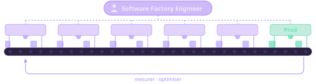
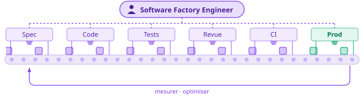

<aside class="notes">
Mathieu
 - Début 2026, on disait : il faut le courage de ne pas générer. Kotzilla : du code généré sans intention de design, ça ne fait pas un système, ça fait un tas. Donc on pense l'archi d'abord, on délègue ensuite.
 - Ça n'a pas tenu longtemps. Les agents génèrent de toute façon, et en volume. Se retenir de lancer l'agent n'est plus le sujet.
 - Le sujet, c'est la chaîne autour : spec, tests, revue, CI, prod. On l'outille pour que ce qui en sort reste cohérent.
 - Exemple : un skill comme grill-me intervient dès le début de la chaîne. Avant la moindre ligne de code, il nous questionne sur la spec jusqu'à ce qu'elle tienne debout.
 - L'intention de design est toujours là, on l'écrit dans la chaîne : specs, tests, règles d'archi, garde-fous.
 - Et on mesure ce qui arrive en prod pour améliorer la chaîne elle-même. Notre travail de conception porte maintenant sur la fabrique.
 - Pour concevoir cette chaîne, il faut monter d'un cran → Mathieu
</aside>

---

<!-- .slide: class="slide-section" -->

4b

## Monter d'un cran

<aside class="notes">
Mathieu
 Rappel de ce que stéphane me dit : "tu me dis de sortir de mes acronymes, penser produit etc.
  Time Code 32/33 min
</aside>

---
<!-- .slide: class="slide-section" -->

## La vision globale est à nous
 

## Comprendre pour prompter

<aside class="notes">
Mathieu
  C'est tentant de pas cadrer, de se lancer tête baissée etc. démuplication de skills "Oh je sais faire du css"
</aside>

---

## Prendre de la hauteur

- **Cohérence** : l'IA voit sa tâche et son contexte limité, nous le système
- **Conception** : on décide, puis on délègue
- **Ne pas construire** : l'IA ne dit jamais non
- **Bounded contexts** : à nous de tracer les frontières
- **L'orga, les gens** : ça ne se lit pas dans le repo

Bad code + Good architecture = 😌 &nbsp;&nbsp;|&nbsp;&nbsp; Bad code + <em>Bad architecture</em> = 💀

    

<aside class="notes">
Mathieu
  être archi, c'est etre pragmatique.. claude c'est un yes man
 - Message de la slide : face à l'IA, c'est à nous de prendre de la hauteur. L'agent travaille le nez dans le code, sur la tâche qu'on lui donne. La vue d'ensemble, personne ne la prendra à notre place.
 - Cohérence : l'agent ne voit que le contexte qu'on lui passe. Que le tout tienne ensemble, c'est notre travail, et il faut l'écrire quelque part (specs, règles d'archi, tests) pour qu'il le respecte.
 - Conception : on peut concevoir avec l'agent, mais c'est nous qui tranchons avant de lancer la génération.
 - Ne pas construire : l'IA construira toujours ce qu'on lui demande. Renoncer à une feature ou réutiliser l'existant, c'est une décision d'archi qui reste humaine.
 - Bounded contexts : les frontières entre domaines et les contrats entre équipes, l'IA ne les dessine pas à notre place.
 - Organisation et humains : l'IA ne sait pas qui est en face, et elle ne le vit pas. Les équipes, leurs contraintes, les enjeux politiques, qui décide, qui va maintenir : nous, on est dans les réunions, on connaît les gens. Une archi qui tient compte des humains qui vont la faire vivre, ça reste notre boulot.
 - Bad code + good archi, ça se rattrape. Bad code + bad archi, non. D'où l'intérêt de monter d'un cran.
</aside>

---

## Le métier et son langage restent centraux

Le chef dirige parce qu'il connaît chaque instrument.

<aside class="notes">
Mathieu
  le chef d'orchestre va pas savoir jouer de tous les instruments mais il sait comment les faire parler entre eux
  Se remettre en question si le métier vous interesse pas...
</aside>

---

## Retour aux fondamentaux

- **DDD** : un vocabulaire que l'agent n'invente pas
- **Event Storming, Example Mapping** : le trouver en équipe
- **Archi hexagonale** : régénérer sans tout contaminer
- **Évolutivité** : savoir quand l'archi doit changer

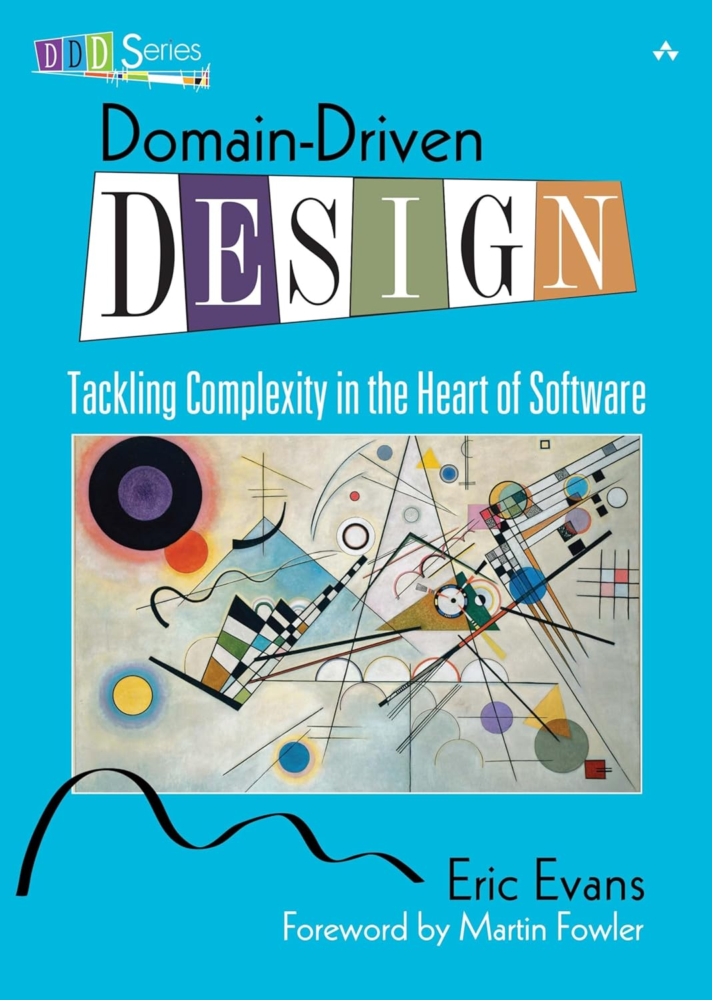
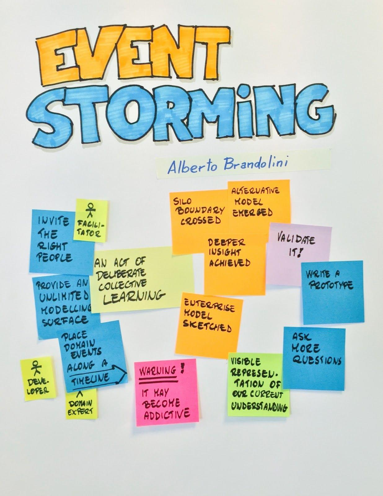
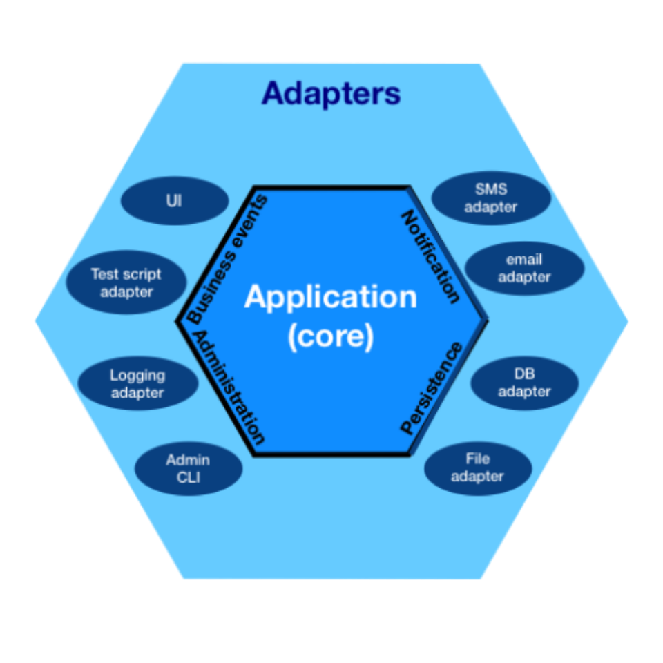

Schéma hexagonal : Cth027, Wikimedia Commons · CC BY-SA 4.0

<aside class="notes">
Mathieu
 - DDD : nommer les concepts du domaine avec précision, c'est donner à l'agent un vocabulaire qu'il ne peut pas inventer seul.
 - Event Storming, Example Mapping : on découvre et on formalise ce vocabulaire en équipe, avant de déléguer.
 - Archi hexagonale : avec des couches indépendantes, on régénère une partie sans contaminer le reste.
 - Évolutivité : l'agent ajoute du code dans la structure qu'il trouve. Il ne viendra pas nous dire que le monolithe est devenu trop gros.
 - C'est à nous de repérer le moment : un module que tout le monde touche, des temps de build qui explosent, deux équipes qui se marchent dessus.
 - Et de décider : modulariser, découper en plusieurs applis, ou ne rien changer si rien ne le justifie. Évoluer quand il faut, pour de bonnes raisons.
</aside>

---

## Entretenir ses savoirs

Faire l'effort d'apprendre

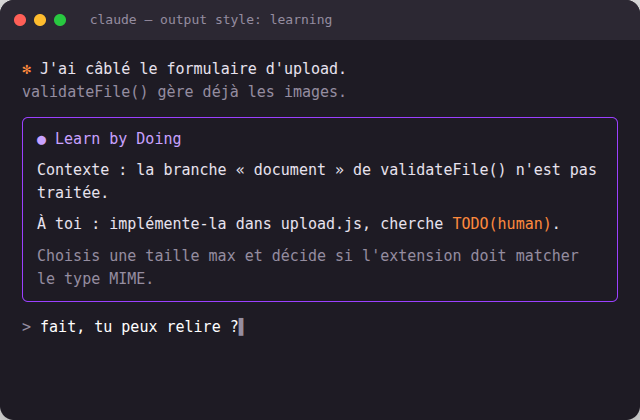
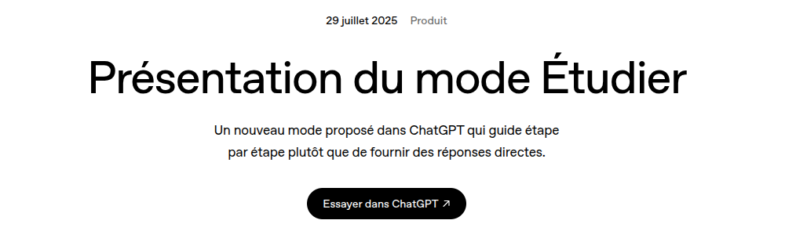

Fin de sprint : générer ses outils

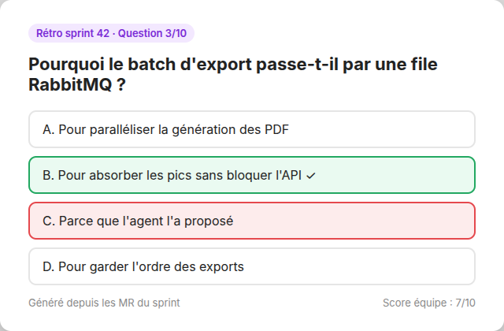
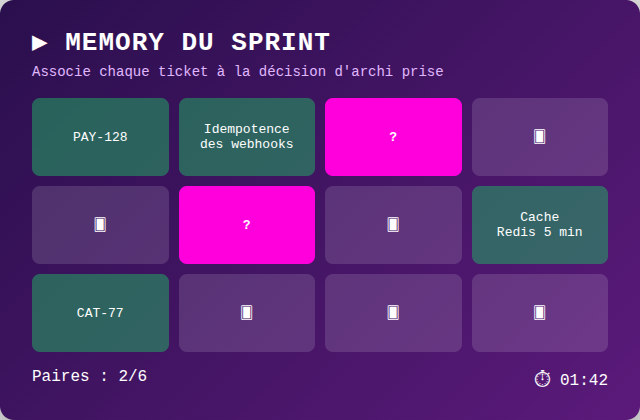
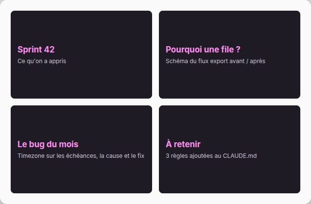

Captures : Claude Code — Output styles · OpenAI — Présentation du mode Étudier · 2025 · QCM, jeu et slides : exemples illustratifs

<aside class="notes">
Mathieu
 - Les outils ont des modes faits pour apprendre : le style Learning de Claude Code laisse un TODO(human) et nous demande d'écrire le morceau qui demande une vraie décision. Le mode Étudier de ChatGPT guide pas à pas au lieu de donner la réponse.
 - Ça prend plus de temps qu'une réponse directe. On l'active sur les sujets où on veut progresser, pas partout.
 - Fin de sprint : on demande à l'agent de générer un QCM, un petit jeu ou quelques slides à partir des MR et des décisions du sprint.
 - L'équipe y joue en rétro. On vérifie qu'on a compris ce qui a été livré, y compris ce que l'agent a écrit.
 - L'agent les génère en quelques minutes, et toute l'équipe repasse sur les sujets du sprint, pas seulement la personne qui a fait la MR.
</aside>

---

## Chercher les nouvelles technicités

🛤️ Platform Engineering IA

Les rails des agents : sandboxes, guardrails, quality gates

🔀 Agent gateway & A2A

Authentifier, router, tracer. MCP vers les outils, A2A entre agents

🩺 SRE IA

Observer, Fiabiliser des décisions non déterministes

📚 Partage des usages

Marketplace, bibliothèques de skills et d'agents, retours d'expérience

🧰 Harness engineering

Concevoir l'environnement de l'agent : outils, mémoire, boucles de feedback

🧪 Evals

Tester un agent comme on teste du code, à chaque changement de prompt ou de modèle

Choisir ce qu'on garde et ce qu'on transmet reste un geste d'artisan.

<aside class="notes">
Mathieu
 - Platform Engineering IA : la même idée que la plateforme interne pour les devs, mais pour des agents. Des sandboxes pour qu'ils ne cassent rien, des garde-fous, des quality gates et des tests de contrat dans la CI. Tout ce qui peut être automatisé l'est, pour garder notre attention sur le reste.
 - Agent gateway : une API gateway placée devant les agents et les serveurs MCP. Elle décide qui a le droit d'appeler quoi, avec quels secrets, et elle trace tout (retour à l'observabilité).
 - A2A (Agent2Agent) : protocole ouvert lancé par Google en 2025 puis confié à la Linux Foundation. Il permet à des agents de fournisseurs différents de se déléguer des tâches. MCP relie un agent à ses outils, A2A relie les agents entre eux.
 - SRE IA : un agent peut répondre différemment à la même entrée. Il faut le surveiller et le fiabiliser autrement qu'un service classique.
 - Partage des usages : chacun bricole ses prompts, ses skills, ses agents dans son coin. Ce qui marche chez l'un doit profiter aux autres. La marketplace en est un outil (ex. notre marketplace interne liksi-tools) : on publie les skills et agents comme des plugins, on les versionne, on les relit, on supprime ceux qui ne servent plus. Mais le partage passe aussi par les retours d'expérience, les démos entre équipes, les pratiques qu'on documente.
 - Harness engineering : terme popularisé par OpenAI en février 2026. Leur équipe a livré un produit interne d'environ un million de lignes, toutes écrites par Codex. Leur constat : au début ça avançait lentement, et le modèle n'y était pour rien. L'environnement de l'agent était trop pauvre. Le travail de l'équipe est devenu de concevoir cet environnement : les outils de l'agent, une carte du code plutôt qu'un énorme fichier d'instructions, et des boucles de feedback pour qu'il vérifie et corrige son propre travail.
 - Evals : un jeu de cas qu'on rejoue à chaque changement de prompt, de skill ou de modèle, pour vérifier que l'agent fait toujours ce qu'on attend. Les tests unitaires des agents.
 - Observabilité, compétence socle (Boris Tane : « The observability layer becomes the feedback mechanism that drives the entire loop. ») : Intent. Build. Observe. Repeat.
 - Observer la prod, et aussi la chaîne : coût, temps de cycle, rejets en revue.
 - Industrialiser de l'IA : sans culture de l'observabilité, l'accélération par l'IA est aveugle, voire auto-destructrice.
 - Et la liste n'est pas finie : il y a un an, la moitié de ces mots n'existaient pas dans nos équipes.
 - Le rythme est trop rapide pour tout mémoriser. Choisir ce qu'on garde et ce qu'on transmet, c'est là qu'on reste artisan.
</aside>

---

<!-- .slide: class="slide-section" -->

4c

## Reprendre la main

<aside class="notes">
Stéphane
  Time Code 41/42min
</aside>

---

## Le goût vient de la friction

Hors-sol Nourrie à la demande, zéro stress. <strong>Aucun goût.</strong>

Pleine terre Soleil, sécheresse, vent. <strong class="text-accent">Le stress concentre les arômes.</strong>

> Ce qui forge notre code, c'est la galère, pas le confort.
<!-- .element: class="fragment" style="margin-top: 20px;" -->

Images : Giancarlo Dessì (CC BY-SA 3.0) · Mhmd.abdrzg (CC BY-SA 4.0) — Wikimedia Commons

<aside class="notes">
Stéphane
 le code généré par l'IA est par nature statistique, générique, et sans signature humaine
Mais c’est un fait, on sait  que les systèmes les plus robustes ont souvent le "grain" de l'imperfection humaine, les aspérités qui rendent le projet solide, incarné par les équipes tech, et c’est dans la difficulté qu’on éprouve du plaisir
</aside>

---

## Réhabiliter la friction

> La friction n'était pas un obstacle. C'était la **leçon**.

- **Le piège du « zéro friction »** : Sans effort, le cerveau ne retient plus rien durablement.
- **La « difficulté désirable »** 
- **L'action** : <s style="opacity:0.6;">éteindre</s> <strong style="color:var(--mauve);">s'aider de l'IA</strong> sur les sujets où l'on veut consciemment apprendre ou consolider une compétence.

Sources : Dax Raad — The most honest take on AI productivity · 2025 ; Robert Bjork — Desirable difficulties · UCLA Bjork Learning Lab

<aside class="notes">
Stéphane
 -La friction n'était pas l'obstacle, c'était la leçon" Quand on galérait pendant 4 heures sur un bug à minuit, on se créait un modèle mental en béton
C'est ce que la psychologie appelle les "difficultés désirables"
 - il faut avoir le courage d'éteindre Copilot ou Claude sur les sujets techniques où l'on a besoin d'apprendre. La friction fait la progression du dev mais aussi une partie du plaisir, si tout devient facile, si tout atteignable dans la minute, sans effort, alors où est le plaisir
 - donc on rétablit de la bonne friction, on choisit ce qu’on veut approfondir ou apprendre et on rétablit cette friction qu’on peut timeboxer, borner avec de l’ia aussi alors on va perdre en efficacité oui, dans un premier temps mais à la fin, le dev et le projet seront gagnant

</aside>

---

## Sanctuariser les temps sans production

- **L'architecture comme contrat** : poser le cadre, l'agent écrit le code, l'architecture décide où il a le droit de l'écrire.
- **L'hygiène de l'ennui** : prendre le temps d'assimiler, d'échanger et d'incarner le code qu'on produit.

Sources : Arnaud Giuliani (Kotzilla) — The Next Software Crisis Won't Be About Writing Code · 2025 ; Charles Gorintin &amp; Maxime Le Bras (Alan) — Intensité, Intelligence Humaine #29 · mars 2026

<aside class="notes">
Stéphane
 - La Clean Architecture n'est pas morte non, c même devenu notre seule vraie barrière de sécurité pour encadrer, contraindre les agents et ça depende du temps de reflexion
 - le rythme devient infernal, l'excitation remplace le stress, et on veut remplir chaque seconde de vide
Appelez à "sanctuariser les temps sans production"
 - c'est bien beau l'artisanat et le temps de séchage, mais comment je justifie ça quand mes concurrents font du vibe coding et pondent 500 PRs par jour ? → slide suivante
</aside>

---

## Mesurer la valeur, pas le volume

- **Le volume n'est pas la valeur** : compter les PR ou les tokens ne dit rien de la valeur produite.
- **Votre vraie limite, c'est la relecture** : on ne livre pas plus vite que ce qu'on sait relire.
- **Le temps de réflexion se finance** : sinon il se paie plus tard, en incidents et en départs de seniors.

+31 %
de PR mergées sans aucune relecture, humaine ou IA

×3
d'incidents en production par PR mergée

Sources : Faros AI — AI Engineering Report 2026: The Acceleration Whiplash · 2026 (équipes à forte adoption de l'IA vs faible adoption) ; Boris Tane — The Software Development Lifecycle is Dead · 2025 (500 vs 10 PR)

<aside class="notes">
Stéphane
 - arrêtez de mesurer la vélocité au nombre de PR ou de tokens consommés.
 - Faros, 22 000 devs : quand l'usage de l'IA est élevé, 31 % de PR en plus partent sans aucune relecture, et chaque PR mergée a trois fois plus de chances de provoquer un incident.
 - Les concurrents qui pondent 500 PR par jour ? Ça ne tient pas dans le temps : ils accumulent du code que personne n'a lu.
 - Si vous ne financez pas le temps de réflexion de vos devs, vous n'accélérez pas votre entreprise. Vous accélérez la création de votre dette technique et de votre code mort.
 - Et ce sont vos meilleurs seniors qui absorbent la relecture. Ce sont eux qui partiront en premier.
</aside>

---

## En 2027, qu'est-ce qu'on met en place   pour garder le plaisir ?

❓ Prendre le temps

Challenger la demande, décider ce qui mérite d'exister

🛠️ Construire la fabrique

Outiller la chaîne de l'équipe : skills, agents, garde-fous

🧗 Garder de la friction

Coder soi-même ce qu'on veut encore apprendre

🤝 Le plaisir vient de l'autre

Plus de temps avec l'équipe et les utilisateurs

<aside class="notes">
Stéphane & Mathieu (1 par 1)
 - Stéphane, Prendre le temps : les heures qu'on ne passe plus à taper, on les met dans la demande. On la challenge, on décide ce qui mérite d'exister. C'est le Product Engineer de tout à l'heure.
 - Mathieu, Construire la fabrique : tout est à inventer. On outille la chaîne de l'équipe (skills, agents, garde-fous) et on choisit ce que le modèle voit. Notre craft s'exerce maintenant sur cette chaîne.
 - Stéphane, Garder de la friction : on choisit ce qu'on veut encore apprendre et on le code soi-même, même si ça prend plus longtemps. La tomate de pleine terre. C'est aussi comme ça que les juniors deviendront seniors.
 - Mathieu, Le plaisir vient de l'autre : on était seuls face à un agent qui dit oui à tout. Libérés de la syntaxe, on passe plus de temps avec l'équipe et les utilisateurs pour comprendre leur besoin.
</aside>

---

<!-- .slide: class="slide-closing" -->

<!-- .element: style="width:120px; margin-bottom: 32px;" -->

## Merci de votre attention. Et bon courage 😉

### 🎤 À vous le micro

Vos questions, vos témoignages.
<!-- .element: style="margin-top: 24px;" -->

📝 Notre blog tech <a href="https://blog.liksi.io/" style="margin-top:6px;">blog.liksi.io</a>

📡 Notre radar IA <a href="https://ai-radar.liksi.io/" style="margin-top:6px;">ai-radar.liksi.io</a>

